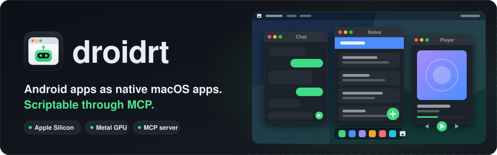
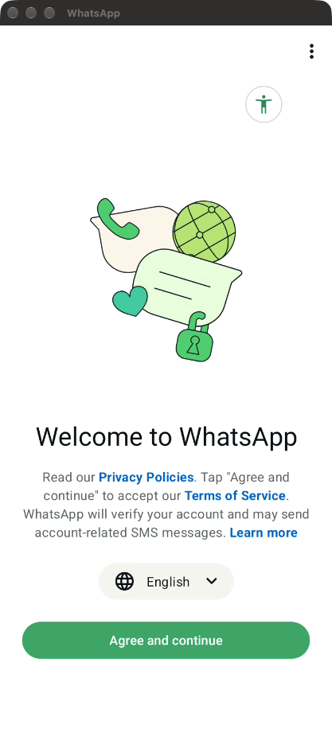
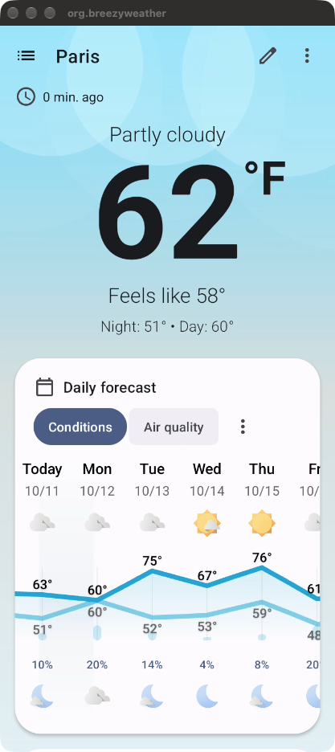
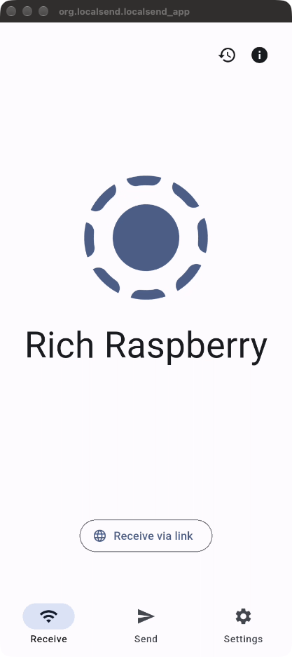
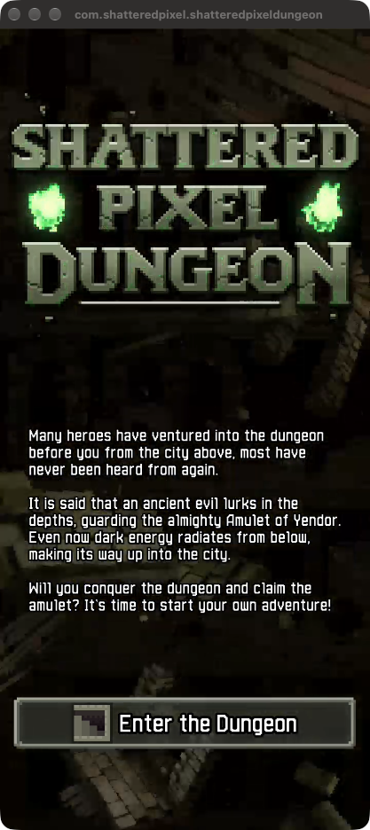
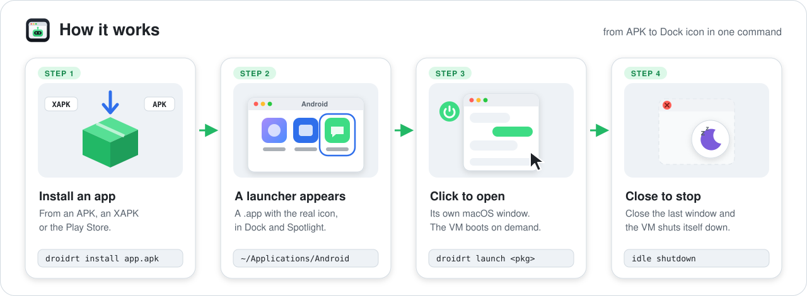
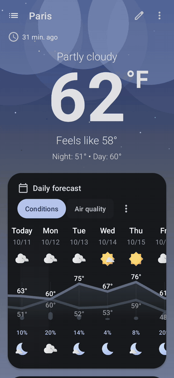
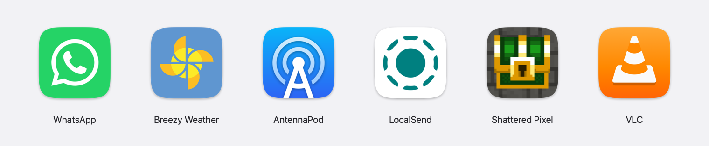
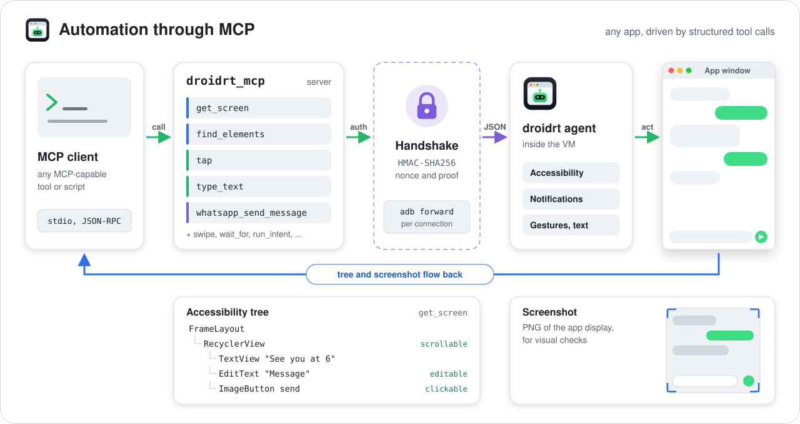
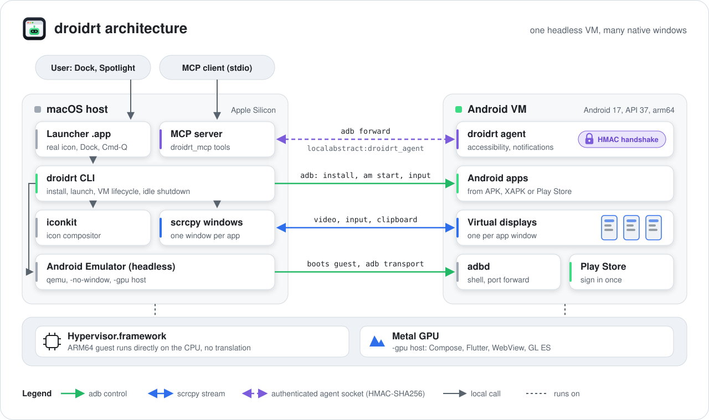

<p align="center">
  <picture>
    <source media="(prefers-color-scheme: dark)" srcset="docs/assets/banner-dark.svg">
    <source media="(prefers-color-scheme: light)" srcset="docs/assets/banner-light.svg">
    
  </picture>
</p>

<p align="center">
  <a href="https://github.com/alissonlinneker/droidrt/actions/workflows/ci.yml"></a>
  <a href="LICENSE"></a>
  
  
  
</p>

<p align="center"><b>Run Android apps on Apple Silicon Macs as if they were native macOS apps.</b></p>

Each Android app gets its own `.app` bundle in `~/Applications/Android`, with its real icon. It shows up in the Dock and Spotlight, opens in its own window and quits with Cmd-Q. Behind the scenes, a single headless ARM64 Android VM runs on Hypervisor.framework, and every app is drawn in its own window through a scrcpy virtual display. A built-in MCP server lets agents operate any installed app.

<p align="center">
  
  
  
  
</p>

## Contents

- [Why](#why)
- [How it works](#how-it-works)
- [Demo](#demo)
- [Requirements](#requirements)
- [Installation](#installation)
- [Quick start: WhatsApp](#quick-start-whatsapp)
- [Commands](#commands)
- [Automation through MCP](#automation-through-mcp)
- [Compatibility and limits](#compatibility-and-limits)
- [Environment variables](#environment-variables)
- [Architecture](#architecture)
- [Performance](#performance)
- [Development](#development)
- [Legal notice](#legal-notice)
- [Credits](#credits)
- [License](#license)

## Why

Running an Android app on a Mac usually means opening a full emulator window with a phone skin, a toolbar and a home screen you have to navigate. droidrt hides all of that:

- **No heavy emulator UI.** The Android Emulator runs headless (`-no-window`). There is no skin, no emulator toolbar and no Android home screen. You only see the app.
- **Native ARM64 execution.** Android needs a Linux kernel (binder, ashmem, cgroups), so a VM is unavoidable. droidrt uses the smallest practical one: an ARM64 guest on Hypervisor.framework. App code runs directly on the CPU, with no instruction translation.
- **Metal GPU.** Rendering goes through the Mac GPU (`-gpu host`, backed by Metal), so Compose, Flutter, WebView and OpenGL ES games are smooth.
- **One window per app.** Each app gets its own Android virtual display and its own macOS window, with physical keyboard and IME support.
- **Feels like a Mac app.** A small AppKit launcher per app puts it in the Dock, brings its window to the front and quits it with Cmd-Q. Adaptive icons are rendered from the APK with the macOS icon mask.
- **Starts and stops by itself.** Opening any launcher boots the VM when needed (20 to 40 s on a cold start). The VM shuts down 120 s after the last window closes.
- **Hardware passthrough.** The built-in Mac camera becomes the Android back camera, Android audio plays through CoreAudio, the clipboard is shared both ways and the microphone can be enabled on demand.

## How it works

<picture>
  <source media="(prefers-color-scheme: dark)" srcset="docs/assets/how-it-works-dark.svg">
  
</picture>

## Demo

<p align="center">
  
  &nbsp;&nbsp;
  
</p>

```sh
$ droidrt install ~/Downloads/WhatsApp.apk
# Boots the VM if it is stopped, installs the APK, renders its adaptive icon
# and creates ~/Applications/Android/WhatsApp.app

$ open ~/Applications/Android/WhatsApp.app
# WhatsApp opens in its own macOS window, with its own Dock icon.
# Cmd-Q closes it. Two minutes after the last window closes, the VM powers off.

$ droidrt store
# Opens Google Play in its own window. Apps you install there get
# launchers automatically when the store window closes.
```

## Requirements

- A Mac with Apple Silicon (M1 or newer) running macOS 13 Ventura or later
- Xcode Command Line Tools, for `swiftc` (`xcode-select --install`)
- Python 3.10 or newer from Homebrew (`/opt/homebrew/bin/python3`, the interpreter in the `droidrt.py` shebang)
- [Homebrew](https://brew.sh) packages:
  - `scrcpy` 5.0 or newer
  - `android-commandlinetools` (provides `sdkmanager` and `avdmanager`)
- Android SDK packages installed with `sdkmanager`: `emulator` 37 or newer, `platform-tools`, `build-tools`, `platforms;android-34` (for the automation agent) and the system image `system-images;android-37.0;google_apis_playstore;arm64-v8a` (Android 17, API 37, with Google Play)
- About 10 GB of free disk space for the SDK, the system image and the 8 GB data partition of the VM

## Installation

```sh
# 1. Toolchain
xcode-select --install                       # skip if already installed
brew install python scrcpy
brew install --cask android-commandlinetools

# 2. Android SDK packages (the Homebrew cask uses this SDK root)
export SDK=/opt/homebrew/share/android-commandlinetools
yes | sdkmanager --sdk_root="$SDK" --licenses
sdkmanager --sdk_root="$SDK" "platform-tools" "emulator" "build-tools;34.0.0" \
  "platforms;android-34" "system-images;android-37.0;google_apis_playstore;arm64-v8a"

# 3. droidrt
git clone https://github.com/alissonlinneker/droidrt.git
cd droidrt
make install                                 # builds the launcher and icon tools, links droidrt into your PATH
droidrt setup                                # creates the headless AVD
```

Notes:

- droidrt itself works with any recent `build-tools` (it picks the newest `aapt2` it finds). The device agent used by the MCP server is built against `build-tools;34.0.0` and `platforms;android-34` by default (override with `BUILD_TOOLS` and `PLATFORM`).
- `sdkmanager` and the agent build need a JDK. If none is installed, run `brew install openjdk`.
- `make install` creates a symlink at `$(PREFIX)/bin/droidrt`. `PREFIX` defaults to `/opt/homebrew` (or `/usr/local` when there is no `/opt/homebrew`). Override it with `make install PREFIX=$HOME/.local`.
- Keep the clone where it is. Generated launchers call `droidrt.py` from this checkout.
- If your SDK lives somewhere else (for example Android Studio's `~/Library/Android/sdk`), set `DROIDRT_SDK`.

## Quick start: WhatsApp

droidrt never ships or redistributes apps. You bring the app yourself, from the official source.

1. **Get WhatsApp**, using one of these options:
   - Download the official APK from [whatsapp.com/android](https://www.whatsapp.com/android) and install it:
     ```sh
     droidrt install ~/Downloads/WhatsApp.apk
     ```
   - Or open Google Play inside droidrt with `droidrt store` (or `Google Play Store.app`), sign in with your Google account and install WhatsApp there. Its launcher is created when the store window closes.
2. **Open it** with `open ~/Applications/Android/WhatsApp.app`, from Spotlight or by double clicking it in Finder.
3. **Link it to your phone instead of registering the number.** On the welcome screen, tap the three dots menu and choose **Link as companion device**, then scan the QR code with WhatsApp on your phone (Settings, Linked devices). Registering your number directly in the VM moves your account to it and logs WhatsApp out of your phone.
4. The first time WhatsApp uses the camera or the microphone, macOS asks for permission for the launcher (named "WhatsApp"). The microphone is only passed through when `DROIDRT_MIC=1`.

Dragging an APK onto any app window installs it. Dragging any other file copies it to `/sdcard/Download` in the VM.

## Commands

| Command | What it does |
|---|---|
| `droidrt install <file>` | Installs an `.apk`, `.xapk`, `.apks` (bundletool or SAI) or `.apkm` and creates its launcher. `--no-launcher` skips the `.app`. |
| `droidrt launch <package>` | Opens an app in its own window from the terminal. `--title` sets the window title. |
| `droidrt store` | Opens Google Play. Launchers are synced when its window closes. |
| `droidrt sync` | Creates or removes launchers to match the apps installed in the VM. |
| `droidrt list` | Lists installed launchers. |
| `droidrt uninstall <package>` | Uninstalls the app and removes its launcher. |
| `droidrt geo <lat> <lon>` | Sets the GPS location of the VM, for example `droidrt geo -23.5505 -46.6333`. |
| `droidrt setup` | Creates or updates the headless AVD. |
| `droidrt start` / `droidrt stop` | Starts the VM and waits for boot, or stops it. |
| `droidrt status` | Shows the VM state. |
| `droidrt mcp` | Runs the MCP server on stdio (see [Automation through MCP](#automation-through-mcp)). |

Without `make install`, run `./droidrt.py <command>` from the clone.

Logs are written to `~/Library/Logs/droidrt/`. State (the agent key, recorded flows, MCP sessions) lives in `~/Library/Application Support/droidrt/`, and APKs pulled from the VM to build semantic tools are cached in `~/Library/Caches/droidrt/apks/`.

## Automation through MCP

<picture>
  <source media="(prefers-color-scheme: dark)" srcset="docs/assets/mcp-flow-dark.svg">
  
</picture>

droidrt includes an MCP (Model Context Protocol) server, `droidrt_mcp`, so MCP clients can operate any installed app: list and open apps, read the screen as an accessibility tree plus a screenshot, find elements, tap, type, swipe, wait for elements, read and reply to notifications, fire intents and record reusable flows. Apps are driven **headless** by default, on an Android virtual display with no macOS window, so automation never takes over the windows you are using.

It relies on a small on-device agent (an AccessibilityService and a NotificationListenerService) that the server builds, installs and enables on first use. The Mac reaches it over an adb forwarded local socket, and every connection is protected by a mutual HMAC handshake with a key kept in `~/Library/Application Support/droidrt/agent.key`.

Register it in any MCP client that reads a JSON configuration, after `make install`:

```json
{
  "mcpServers": {
    "droidrt": {
      "command": "droidrt",
      "args": ["mcp"],
      "env": {"DROIDRT_MCP_PACKAGES": "com.whatsapp"}
    }
  }
}
```

Without `make install`, use `"command": "python3"`, `"args": ["-m", "droidrt_mcp"]` and add `"PYTHONPATH": "/path/to/droidrt"` to `env`. `DROIDRT_MCP_PACKAGES` is optional and limits the server to the apps you list.

| Tools | |
|---|---|
| Generic | `list_apps`, `open_app`, `close_app`, `get_screen`, `find_elements`, `tap`, `type_text`, `swipe`, `press_key`, `wait_for`, `get_notifications`, `reply_notification`, `run_intent`, `record_flow` |
| WhatsApp (curated) | `whatsapp_open_chat`, `whatsapp_draft_message`, `whatsapp_send_message`, `whatsapp_share_text` |
| Other apps | generated from each app's deep links, exported activities and share targets, plus the flows you record |
| Resources | `droidrt://apps`, `droidrt://notifications` |

Per-app tools load in the background after the server starts; clients are told with `notifications/tools/list_changed`. See [docs/mcp.md](docs/mcp.md) for every argument, WhatsApp examples and the security model, and [docs/agent-protocol.md](docs/agent-protocol.md) for the wire protocol.

> Automate only accounts that belong to you and respect the terms of service of each app. For WhatsApp, this means your own account only: its terms forbid bulk and unsolicited messages, and automation can get an account banned. Screen and notification content is untrusted input for the client, so keep a human confirming anything that sends messages.

## Compatibility and limits

Apps with `arm64-v8a` native code, or with no native code at all, work regardless of stack: Kotlin and Java, Jetpack Compose, Flutter, React Native, WebView, OpenGL ES games and C++ engines. The matrix in [`compat/`](compat/) tests ten open source apps from F-Droid across these stacks. In the latest run, with the Mac GPU (`-gpu host`), all ten opened and none crashed; see [docs/compatibility.md](docs/compatibility.md) for the full report and the manual checks.

Some limits cannot be worked around by any Android setup on a Mac:

| Case | Reason |
|---|---|
| Apps with only 32-bit ARM code (`armeabi-v7a`) | Apple Silicon cannot execute AArch32 and the arm64 image has no translation layer. `install` refuses them with a clear message. |
| Apps with only x86 or x86_64 code | The arm64 images have no x86 to ARM translation. |
| Apps that require Play Integrity `DEVICE` or `STRONG` (many banking apps, games with anti-cheat) | The emulator has no hardware attestation, so Google returns an empty verdict. |
| DRM streaming | Without a TEE only Widevine L3 is available: playback is blocked or limited to SD. Screens with `FLAG_SECURE` are shown black. |
| NFC, real Bluetooth, telephony and SMS | There is no equivalent hardware passed through to the VM. |
| Legacy `.apkm` files (encrypted) | Convert them with `unapkm` or download the current format (a plain zip). |

## Environment variables

| Variable | Default | Purpose |
|---|---|---|
| `DROIDRT_CAMERA` | built-in camera | `webcamN`, part of the camera name, `emulated` or `none` |
| `DROIDRT_MIC` | `0` | `1` passes the Mac microphone through (the macOS microphone indicator stays on while the VM runs) |
| `DROIDRT_AUDIO` | `1` | `0` disables VM audio |
| `DROIDRT_GPU` | `host` | `software` if an app shows graphical artifacts (uses the CPU, exposes GLES 3.1) |
| `DROIDRT_DISPLAY` | `720x1560/320` | initial size and DPI of each app display |
| `DROIDRT_MAX_FPS` | `30` | frame rate cap for the window video (use 60 for games) |
| `DROIDRT_BITRATE` | `6M` | bitrate of the window video |
| `DROIDRT_IDLE_GRACE` | `120` | seconds without windows before the VM shuts down |
| `DROIDRT_IMAGE` | `system-images;android-37.0;google_apis_playstore;arm64-v8a` | VM system image (changing it recreates the AVD and its apps) |
| `DROIDRT_SDK` | `/opt/homebrew/share/android-commandlinetools` | Android SDK root |
| `DROIDRT_APPS_DIR` | `~/Applications/Android` | where launchers are created |
| `DROIDRT_AVD` | `droidrt` | AVD name |
| `DROIDRT_PORT` | `5580` | emulator console port (the adb serial becomes `emulator-<port>`) |
| `ANDROID_AVD_HOME` | `~/.android/avd` | where the AVD is stored |
| `DROIDRT_SERIAL` | `emulator-<DROIDRT_PORT>` | MCP server only: adb serial of the device to drive |
| `DROIDRT_MCP_LOG` | `INFO` | MCP server only: log level written to stderr |
| `DROIDRT_MCP_PACKAGES` | unset | MCP server only: comma separated allowlist of packages it may access |

## Architecture

<picture>
  <source media="(prefers-color-scheme: dark)" srcset="docs/assets/architecture-dark.svg">
  
</picture>

- **`droidrt.py`**: the CLI. Manages the AVD, VM lifecycle, installs and launcher generation. Python standard library only.
- **`launcher/`**: the AppKit binary every generated `.app` runs. It starts `droidrt launch`, shows the app in the Dock and forwards Cmd-Q.
- **`iconkit/`**: resolves the launcher icon from the APK (adaptive icons, vector drawables, layer lists) and renders a 1024 px macOS icon with CoreGraphics.
- **`agent-apk/`**: the on-device automation agent.
- **`droidrt_mcp/`** and **`semantic/`**: the MCP server and the per-app semantic tools.
- **`compat/`**: the compatibility matrix runner and its latest report.

Details, with a full diagram, are in [docs/architecture.md](docs/architecture.md).

## Performance

Measured on an M2 Max:

- Idle VM: about 7% CPU and 3 GB of memory
- Each scrcpy window: about 40 MB
- With an app open, the largest cost is the software H.264 encoder inside the VM (the emulator has no hardware encoder). Camera apps add capture and image processing.

## Development

```sh
make build    # launcher, icon compositor and device agent (the agent needs a JDK and the Android SDK)
make test     # unit tests: test_droidrt, test_mcp, semantic/test_semantic.py and iconkit, no VM needed
make clean
```

The compatibility matrix needs a running VM:

```sh
./compat/run_matrix.py --dry-run            # show the plan
./compat/run_matrix.py                      # run every app, write compat/report.md
./compat/run_matrix.py --only org.localsend.localsend_app --seconds 30
```

CI runs on GitHub-hosted Apple Silicon runners: it builds the Swift parts, runs `make test` and rejects any committed APK. See [CONTRIBUTING.md](CONTRIBUTING.md) for guidelines and [SECURITY.md](SECURITY.md) for reporting vulnerabilities.

## Legal notice

droidrt is an independent open source project. It is not affiliated with, endorsed by or sponsored by Google, WhatsApp, Meta or Genymobile.

Android, Google Play and the Google Play logo are trademarks of Google LLC. WhatsApp is a trademark of WhatsApp LLC. All other trademarks belong to their respective owners and are used here only to identify the software they refer to.

droidrt does not include or redistribute any Android app (the compatibility matrix tests open source apps that you download from F-Droid yourself, for testing only). The Android system images and SDK tools are downloaded by you, from Google, under the Android SDK license terms. You are responsible for complying with the terms of service of every app and service you use through droidrt. Automation features must only be used with your own accounts; in particular, automate WhatsApp only on your own account and in line with WhatsApp's terms.

The software is provided "as is", without warranty of any kind. See [LICENSE](LICENSE).

## Credits

- [Android Emulator](https://developer.android.com/studio/run/emulator) and the [Android Open Source Project](https://source.android.com/) (Apache-2.0), which provide the VM and the system.
- [scrcpy](https://github.com/Genymobile/scrcpy) by Genymobile (Apache-2.0), which provides the per-app windows, input and clipboard.
- The open source apps from [F-Droid](https://f-droid.org/) used in the compatibility matrix, under their own licenses.

## License

[MIT](LICENSE). Copyright (c) 2026 Alisson Linneker.
