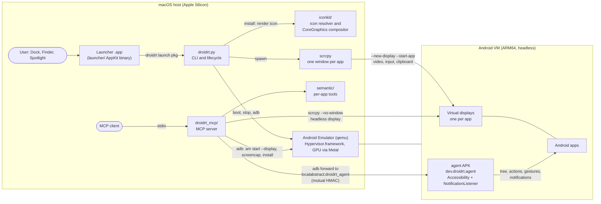
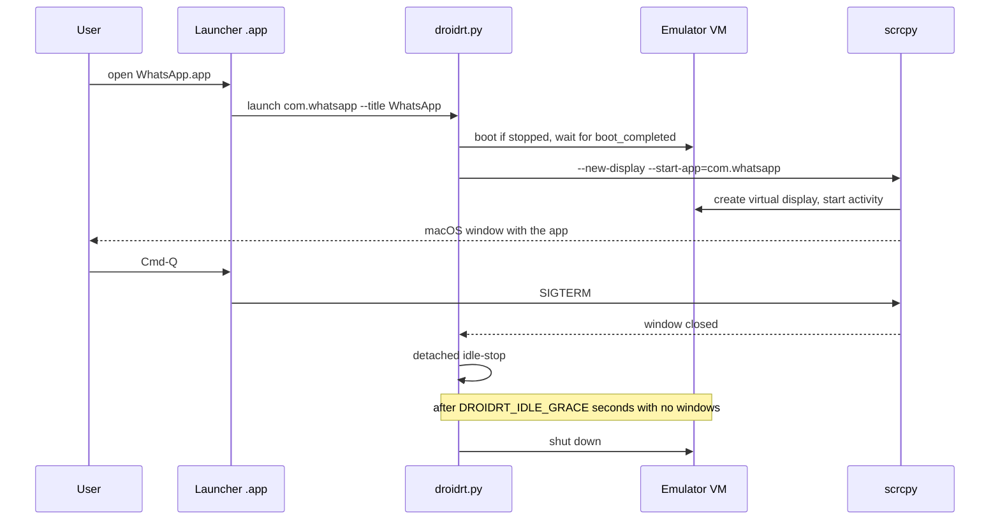

# Architecture

droidrt turns one headless Android VM into many macOS apps. This document explains the moving parts, how they talk to each other and where state lives.

## Overview

## Components

### The VM

- An AVD named `droidrt` (configurable with `DROIDRT_AVD`) built from `system-images;android-37.0;google_apis_playstore;arm64-v8a`.
- The Android Emulator runs it with `-no-window`, no boot animation and no snapshot saving. The guest is ARM64 on Hypervisor.framework, so app code runs natively with no instruction translation.
- Rendering uses the host GPU (`-gpu host`, Metal underneath). `DROIDRT_GPU=software` switches to the CPU renderer for apps that show artifacts.
- The AVD gets 3 GB of RAM, an 8 GB data partition, a hardware keyboard and the built-in Mac camera as the back camera. Android audio is played by the emulator through CoreAudio (`DROIDRT_AUDIO=0` disables it). The host microphone is only opened when `DROIDRT_MIC=1` (`-allow-host-audio`).
- The emulator listens on console port `DROIDRT_PORT` (default 5580), so adb sees it as `emulator-5580`.

### `droidrt.py`

The command line tool and the single owner of the VM lifecycle. It only uses the Python standard library (3.10+) and calls external tools with argument lists.

- **setup:** creates the AVD with `avdmanager` (installing the system image with `sdkmanager` when missing) and applies the hardware settings. Changing `DROIDRT_IMAGE` recreates the AVD.
- **start / stop:** boots the VM and waits for `sys.boot_completed`, or shuts it down.
- **install:** accepts `.apk`, `.xapk`, `.apks` and `.apkm`. Bundles are unpacked into a temporary directory with path traversal checks and size caps (4 GiB in total, 2 GiB per entry). The ABI of the native code is checked first: apps with only 32-bit ARM or x86 code are refused with a clear message. Split APKs are installed with `adb install-multiple`. Then the icon is rendered and a launcher bundle is created.
- **launch:** boots the VM if needed, then runs scrcpy on a new virtual display for that package. Quick scrcpy failures are retried. When the window closes, a detached `idle-stop` process powers the VM off after `DROIDRT_IDLE_GRACE` seconds without windows.
- **mcp:** starts the MCP server from `droidrt_mcp/` on stdio.
- **sync:** compares the packages installed in the VM with the launchers on disk and creates or removes launchers. It runs automatically when the Play Store window closes.

### `launcher/`

A small AppKit binary written in Swift, compiled once by `launcher/build.sh` (ad hoc signed, arm64, macOS 13+), and copied into every generated `.app` as its `CFBundleExecutable`.

- It reads `DroidrtCommand` and the package name from its own `Info.plist` and starts `droidrt.py launch <package> --title <name>` as a child process.
- It appears in the Dock with the app icon, brings the scrcpy window to the front when it appears, and sends SIGTERM to the window on Cmd-Q. It exits when the child exits.
- Because each app is a separate bundle with its own name, macOS privacy prompts (camera, microphone) name the app the user recognizes.

### `iconkit/`

Extracts a 1024 x 1024 macOS style icon from one or more APKs.

- `iconkit.py` resolves the launcher icon through `aapt2`: the manifest icon, then the resource table of every APK including density splits. References are followed down to concrete drawables: bitmaps, colors, vector drawables, layer lists, insets, shapes and selectors. Adaptive icons are composed from their background and foreground layers.
- The result is a JSON spec, rasterized by `compose.swift` (CoreGraphics), which also applies the macOS icon mask.
- APKs are treated as untrusted data: nothing inside them is executed, entries are read into memory with a 32 MiB cap, every recursive lookup stops at depth 16, drawable nodes and path commands are counted against fixed budgets, and bitmaps larger than 4096 px per side are skipped. `compose.swift` enforces its own limits on the spec size, node count, path commands and vector depth.

### scrcpy

scrcpy provides the per-app window. Audio does not go through scrcpy (it runs with `--no-audio`); the emulator plays it directly. droidrt asks it for a new Android virtual display that starts the package (`--new-display`, `--start-app`), keeps the IME local to that display, uses UHID keyboard input, and handles the clipboard and drag and drop (APKs are installed, other files are copied to `/sdcard/Download`).

### Agent APK (`agent-apk/`)

An on-device agent, package `dev.droidrt.agent`, with two services:

- `.AgentService`: an AccessibilityService that exposes the view tree of every display, runs node actions and dispatches gestures on a given display.
- `.NotifyService`: a NotificationListenerService that keeps active notifications and a ring buffer of recent ones, and can trigger notification actions, including quick replies through RemoteInput.

- `.KeyReceiver`: a broadcast receiver, protected by `android.permission.DUMP`, that stores the shared key sent by the host.

It listens on the abstract local socket `droidrt_agent` and serves only uid 2000 (shell) and uid 0 (root). The host reaches it through `adb forward tcp:<port> localabstract:droidrt_agent` and speaks newline-delimited JSON. Every connection starts with a mutual HMAC-SHA256 handshake: the agent sends a nonce, the host answers with an HMAC of it under the shared key plus its own nonce, and the agent proves the same key back. The key is 32 random bytes kept on the Mac in `~/Library/Application Support/droidrt/agent.key` (mode 0600). The protocol is specified in [agent-protocol.md](agent-protocol.md) and the security model in [agent-apk/README.md](../agent-apk/README.md#security-model).

### MCP server (`droidrt_mcp/`) and semantic tools (`semantic/`)

The MCP server runs on the Mac over stdio, started with `droidrt mcp` or `python3 -m droidrt_mcp`. It combines adb (install, `am start`, screenshots) with the device agent (screen reading, element actions, gestures, notifications) and exposes them as MCP tools and resources.

- **Headless sessions.** By default an app is driven on a virtual display with no window: the server runs `scrcpy --no-window --no-control --new-display` with a 1 fps stream recorded to `/dev/null` to keep the display alive, then starts the app on it with `am start --display <id>`. An app that already has a droidrt window is driven in its window instead. Headless sessions end on `close_app` and when the server exits.
- **Semantic tools.** `semantic/` adds per-app tools from three sources, in order of precedence: curated definitions (for example the four WhatsApp tools in `semantic/curated/com.whatsapp.json`), flows recorded with `record_flow` and tools generated from the app manifest (browsable deep links, exported activities, share targets). The manifest is read from the base APK, pulled once per version into `~/Library/Caches/droidrt/apks/`. These tools load in a background thread after startup, and the server sends `notifications/tools/list_changed` when they are ready or when a flow is recorded.

See [mcp.md](mcp.md).

### `compat/`

`run_matrix.py` installs every app listed in `apps.json` (open source apps downloaded from F-Droid beforehand, verified by sha256) on a running VM, opens each one on a fresh virtual display while recording, grabs the last frame, checks the crash buffer and samples qemu CPU usage. The results go to `compat/report.md`. See [compatibility.md](compatibility.md).

## Lifecycle of a launch

## State on disk

| Path | Content |
|---|---|
| `~/Applications/Android/` (`DROIDRT_APPS_DIR`) | generated launcher bundles |
| `~/.android/avd/droidrt.avd` | the AVD, including the data partition with installed apps and accounts |
| `~/Library/Application Support/droidrt/agent.key` | shared key for the device agent handshake (mode 0600) |
| `~/Library/Application Support/droidrt/flows/<package>/` | flows recorded with `record_flow` |
| `~/Library/Application Support/droidrt/mcp-sessions.json` | headless sessions of the MCP server |
| `~/Library/Logs/droidrt/` | VM, window, launcher and MCP session logs |
| `~/Library/Caches/droidrt/apks/` | base APKs pulled from the VM to generate semantic tools |
| `~/Library/Caches/droidrt/compat-apks/` | APKs used by the compatibility matrix (downloaded by you) |
| `agent-apk/build/` | the built agent APK and its local debug keystore (ignored by git) |

## Design principles

- **Standard library only** on the Python side, and Swift with system frameworks on the native side. No package manager is needed to run droidrt.
- **Untrusted input:** APKs and bundles are parsed as data, extracted with path checks and never executed on the host.
- **No shell interpolation:** every subprocess receives an argument list, `shell=True` is never used, and arguments of commands run inside the VM are quoted.
- **Untrusted automation input:** every MCP tool argument is validated, and screen and notification content is treated as untrusted data.
- **Nothing is redistributed:** droidrt ships no APKs and no Android images. Users install apps from official sources.
